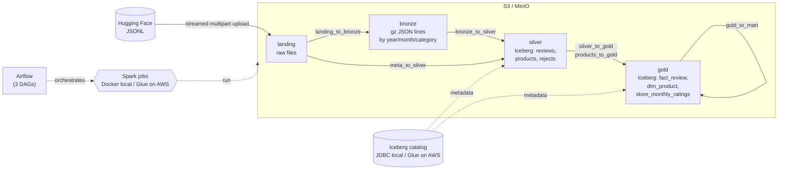

# amazon-reviews

Batch lakehouse pipeline over the [Amazon Reviews 2023](https://huggingface.co/datasets/McAuley-Lab/Amazon-Reviews-2023)
dataset: raw JSONL from Hugging Face → bronze → silver → gold (Iceberg) → a monthly store-ratings mart.
The same PySpark jobs run locally (Docker + MinIO) or on AWS (Glue + S3), selected by
`SPARK_BACKEND` and the `.env` config (on AWS the Glue jobs, IAM roles and buckets are set up
separately).

**Stack:** Airflow 3 · Spark 4.1 · Apache Iceberg · AWS (S3, Glue 6.0, Glue Data Catalog, EC2) ·
MinIO + Postgres locally · Python, uv, ruff, pytest

## Architecture

**DAGs:** `reviews_ingest` (download + bronze per category), `products` (download + silver per
category → `dim_product`), `reviews_monthly` (one month: silver → gold → mart; covers the dataset span
1996-05..2023-09, months are loaded with Airflow backfill).

## Design notes

- Bronze keeps raw lines (ELT); lines without a derivable year/month go to a quarantine prefix
  in the bronze bucket. Silver applies the validity rules; invalid reviews go to
  `silver.reviews_rejected`.
- Silver deduplicates deterministically; writes overwrite partitions or whole months instead of
  appending, so reruns don't duplicate data.
- Jobs are plain PySpark (no `GlueContext`), so local and cloud run the same code with different conf.
- Spark is chosen for scale-out, not speed at this size: a monthly run is mostly Glue/JVM
  start-up, and a single-node engine would likely handle one month faster and cheaper.
- Known limitation: in media categories (Books, Kindle_Store, CDs_and_Vinyl, Movies_and_TV,
  Digital_Music) the source `store` field holds the author/artist plus a format string
  (e.g. `Elvis Presley   Format: Audio CD`), so store-level results there are per creator.

## Scale & cost

Full load on AWS (Glue 6.0 Flex, G.1X, auto scaling up to 10 workers), November 2026:

| | |
|---|---|
| Raw input | 34 categories, 377 GB JSONL (275 GB reviews + 101 GB product metadata) |
| Bronze | 81.6 GB gzip JSON lines, 9,496 files |
| Silver / gold | 565,555,080 reviews (silver = `fact_review` = sum of the mart's counts), 151 rejected; 35,393,189 products |
| Monthly load | 326 non-empty months, ~4.5 h with 4 months in parallel; ~3 min per month |
| Glue cost | ~$27 for the full load (billed), ~$0.08 per monthly run on average |

## Running

The project was set up and run by hand; these are the general steps, not a turnkey setup.

- **Locally:** Docker (≥ 8 GB memory), uv. Copy `.env.example` to `.env` (set
  `HOST_PROJECT_DIR` to the repo's absolute path), then `uv sync`, `uv run poe spark-build` and
  `uv run poe dev-start` (Airflow, MinIO, Postgres).
- **On AWS:** provision the S3 buckets, the Glue Data Catalog databases, the six Glue jobs
  (scripts from `spark/src`, max concurrent runs above Airflow's limit of 4) with their IAM role,
  and an EC2 instance with an instance role for Airflow. Run `docker-compose.yaml` there with the
  AWS block of `.env.example` (`SPARK_BACKEND=glue`).
- **Load:** trigger `reviews_ingest` and `products`, then backfill `reviews_monthly` over
  1996-05..2023-09: one month first (it creates the tables), then the rest with
  `airflow backfill create --max-active-runs 4`; empty months are skipped.

**Tests:** `uv run pytest` (DAGs) · `uv run poe spark-test` (Spark jobs, in the Spark image).
